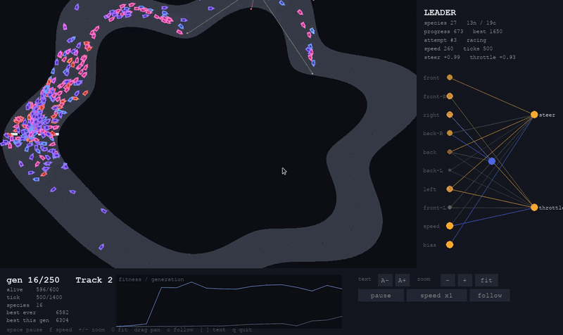

# cars

Self-driving cars evolved with NEAT. No hand-written driving logic - just
wall-detecting sensors, a neural net, and a genetic algorithm.



<sub>Generation 16 of a live run. The panel on the right is the leader's actual network:
its inputs are wall distances and its own speed, its outputs are steering and
throttle, and the hidden nodes between them were added by mutation, not by design.
A browser version you can run without installing anything is at
[neat-from-scratch](https://github.com/MarcoZorn/neat-from-scratch).</sub>

## What it does

- 1000 cars, 30 procedurally generated tracks, 250 generations
- each car has 16 raycast sensors in a full ring, one every 22.5 degrees
  plus its own speed as inputs, steering and throttle as outputs
- crashing doesn't end a car's race - it respawns at the start line and keeps
  trying until it finishes a lap or runs out of time
- fitness is the best single attempt, not the sum of attempts (so crash-spamming
  doesn't help)
- standard NEAT: speciation, fitness sharing, elitism, crossover, mutation

Tracks cycle each generation so the population doesn't just memorize one loop.

## Running it

```
pip install -r requirements.txt
python run.py
python run.py --hard   # sharper, narrower tracks, pillars on the hardest
python run.py --load saves/gen0040.pkl.gz   # carry on from a save
python run.py --set n_rays=8 sharing=square   # watch any experiment below, any Config field
```

Controls:

- `space` pause
- `f` speed (1x / 4x / 16x)
- `+` / `-` / mouse wheel zoom, drag to pan, `0` to fit
- `c` follow the leader car
- `s` save the population to `saves/` (resume it with `--load`)
- `[` `]` UI text size
- `q` quit

Headless, no window - evolve several seeds in parallel and score each run's
best generalist on all 15 tracks (laps, lap fraction, lap time):

```
python bench.py --seeds 8 --pop 200 --gens 20
python bench.py --set p_weight=0.5 weight_step=0.15   # any Config field
python bench.py --set track_hardness=1.6 track_obstacles=3   # the hard set
```

The winner is also raced on fifteen held-out tracks it never saw in
training, same difficulty curve, different seeds. On the standard set the
task saturates (by generation 40 nearly every run laps every training
track), and the held-out score is what still separates runs. The hard set
(sharper, narrower tracks, pillars on the hardest) does not saturate.
16 seeds, population 200, 40 generations, with the defaults as they are now
(weight step 0.6 and fitness sharing fixed, both below), and in brackets as
they were before either:

| | training laps / 15 | held-out laps / 15 | gap |
|---|---|---|---|
| standard tracks | 14.9 (14.4) | 13.7 (13.1) | 1.2 (1.3) |
| hard tracks | 14.1 (12.9) | 12.9 (10.8) | 1.2 (2.1) |

Bigger weight mutations generalise better. With the weight step raised from
0.35 to 0.6 (now the default), over 32 seeds on the hard set the held-out
score went from 11.0 to 12.3 laps, and on the standard set from 13.1 to 13.5,
with training scores up as well. A wider search finds drivers that rely less
on the exact shape of the tracks they trained on.

Tried on the hard set and not kept: scoring progress as a share of each
track's lap instead of in pixels (the tracks differ in length by about 2x, so
raw distance is not comparable from one generation to the next) came out at
13.0 and 11.0, inside the noise between seeds.

Do the rear rays earn their place? Five rays over the front half (the same
five angles as the front of the ring: ahead, the diagonals, and both sides)
against the full ring of eight, 32 seeds on the hard set:

| | training laps / 15 | held-out laps / 15 | held-out lap time, ticks |
|---|---|---|---|
| ring of 8 | 13.5 | 12.1 | 248 |
| front 5 | 13.8 | 12.1 | 274 |
| front 5 + back diagonals | 13.8 | 11.9 | 281 |

Exactly as many laps either way, but a driver with the whole ring laps about
a tenth faster. My guess was the back diagonals: coming out of a corner they
still see the wall the car is pulling away from. Wrong: with them and
without the ray pointing straight back (`n_rays=7 fov=1.5pi`) it is as slow
as the front five alone. Whatever the full ring gives, it takes the ray
that looks straight back, or the whole set. The ring stays.

**A bug in fitness sharing.** NEAT divides each genome's fitness by the size
of its species, and gives each species offspring in proportion to the sum of
those shares, which comes to the species' mean fitness. This code averaged
the shares instead of summing them, dividing by the species' size a second
time, so a species twice as big got half the offspring it should have. With
the standard rule (`sharing="mean"`, now the default), hard set, two batches
of 32 seeds:

| offspring per species | training laps / 15 | held-out laps / 15 | held-out lap time |
|---|---|---|---|
| mean fitness / size (the bug) | 13.5 / 13.2 | 12.1 / 11.8 | 248 / 232 |
| mean fitness (standard) | 13.9 / 13.8 | 12.5 / 12.4 | 260 / 243 |
| total fitness (no sharing) | 14.1 | 12.5 | 279 |

Half a lap more on unseen tracks in both batches, at laps about 5% slower.
No sharing at all matches it on laps and is slower still. With the fix in, the
weight step still holds up (hard set, 32 seeds, held-out laps): 11.5 at
0.35, 12.5 at 0.6, 12.6 at 0.9. It stays at 0.6. The comparisons
above this one, other than the first table, were measured with the bug in
place.

**Does a car need to feel its own speed?** The network has no memory, so
without the speed input it cannot tell how fast it is going; the rays look
the same at any speed. I expected that to be crippling. With the input
silenced (`speed_input=False`), hard set, the same 32 seeds:

| | training laps / 15 | held-out laps / 15 | held-out lap time |
|---|---|---|---|
| with speed | 13.9 | 12.5 | 260 |
| without | 13.6 | 12.3 | 236 |

A quarter of a lap worse, and faster laps. Not knowing your speed seems to
mean keeping your foot down and steering by the walls alone, which crashes
a little more and laps a tenth quicker when it works. The input stays, but
it is doing much less than I thought.

**How many rays?** Hard set, held-out laps, 32 seeds:

| rays in the ring | 3 (front half) | 8 | 12 | 16 | 24 |
|---|---|---|---|---|---|
| held-out laps / 15 | 8.7 | 12.5 | 12.5 | 13.2 | 13.2 |

Sixteen against eight again on 32 fresh seeds: 13.5 against 12.4, and laps
5% faster. That is the biggest single gain in this README, for about 1.8
times the compute per generation, and 16 is now the default. Past 16 it
stops paying. (The eight-ray results above still stand as comparisons among
themselves.)

**How many training tracks?** Each generation races one track, cycling
through the set, so more tracks costs nothing extra. Hard set, 16 rays, 32
seeds, as a share of tracks lapped (the held-out set is the same size as the
training set, so laps out of 15 would not compare):

| training tracks | training tracks lapped | held-out tracks lapped |
|---|---|---|
| 5 | 100% | 87.6% |
| 15 | 93.9% | 87.7% |
| 30 | 98.4% | 91.3% |

Five tracks are learned perfectly and generalise no better than fifteen;
thirty generalise best, for free. On the same exam (`--holdout 15`, now
the default, so every number here stays out of 15), two batches of 32 seeds:
13.53 and 13.69 held-out laps training on thirty tracks, against 13.16 and
13.53 on fifteen. Small, but the same way twice and it costs nothing, so
the default is now thirty. One snag on the way: the thirty-track set's track
28 pinched to a half-width of 19.5, under the three car widths (21) every
standard track is meant to keep. The generator now tones down a chicane
that breaks that rule, on standard tracks only, so the hard sets keep their
pinches and every training set above is unchanged bit for bit. The one track
it did change is held-out standard track 14 (19.2 to 21.0), so standard
held-out scores from here on face a very slightly kinder exam.

With all of that in (16 rays, fixed sharing, 30 training tracks), is more
training time worth it? Hard set, 32 seeds: 40 generations, 13.53 held-out
laps out of 15; 80 generations, 13.56. Training is solved by 40 (29.5 and
29.8 of 30 training tracks lapped), and doubling it adds nothing on tracks
it has not seen. What is left, about a lap and a half of the held-out set,
is not a matter of practice. Nor of how the same compute is spent: 100 cars
for 80 generations, 200 for 40 and 400 for 20 score 13.44, 13.53 and 13.28,
inside the noise (the small population is the quickest to run, 676 seconds
against 1051 and 1805).

It is mostly one track. Which held-out tracks the best generalist laps, over
16 seeds:

| held-out track | 1-10 | 11 | 12 | 13 | 14 | 15 |
|---|---|---|---|---|---|---|
| lapped by | 15-16 each | 13 | 16 | 13 | 0 | 16 |

Track 14, never. It is not impossible: a population raised on it alone laps
it within 0 to 19 generations in eight seeds of eight (two of them in the
first generation, by luck). It is a hard-set track with three pillars and
its narrowest point at 20.2 px of half-width, and whatever it asks for is
something no combination of the thirty training tracks teaches. One track
the generalists all fail and a specialist learns in minutes is the gap
between training and held-out scores in its plainest form.

Which part of it? The same sixteen generalists on track 14 with its
pillars taken away and everything else unchanged: 11 of 16 lap it. The
pillars are most of the problem, the shape the rest. Pillars are not new to
them, the hardest training tracks have two or three, so it is presumably
where these ones stand, near the pinch, that nothing in training
resembles.

More pillars in training, then? Up to six on the hardest training tracks,
the exam left at three (`--set track_obstacles=6 --exam track_obstacles=3`):
13.47 held-out laps, against 13.53. No better. (Now and then a seed does
lap all fifteen, here and in earlier runs, so track 14 is not beyond a
generalist; more pillars in general is just not what teaches it.)

**One-handed drivers.** Every track is driven the same way round, so the
drivers learn to drive one way round. Mirroring a track top to bottom (`Track(...,
mirror=True)`) makes it go the other way; the best generalist of sixteen
seeds, hard set, on the fifteen held-out tracks each way:

| raised on | held-out laps, the usual way | mirrored |
|---|---|---|
| tracks all going one way | 13.6 | 9.1 |
| every other track mirrored (`both_ways=True`) | 13.2 | 13.1 |

A third of a lap given up the usual way round for four laps gained the other
way. Even a ring of sixteen rays, which sees the road symmetrically, learns
a one-handed habit when every lap it trains on goes round the same way.
`both_ways` stays off by default only so that the numbers above stay
comparable; `python run.py --set both_ways=true` raises two-handed drivers.
(The same thing in the browser version, more extreme: there the one-way
record holder lapped nothing mirrored, and the best generalist 24 laps
against 106.)

## Files

- `neat_core/` - genome, mutation, crossover, speciation (standard NEAT)
- `tracks.py` - track generation (polar functions, always simple closed loops)
- `car.py` - physics, sensors, fitness
- `app.py` / `render.py` - the live viewer
- `bench.py` - headless multi-seed benchmark
- `test_cars.py` - `python test_cars.py`

MIT licensed.
